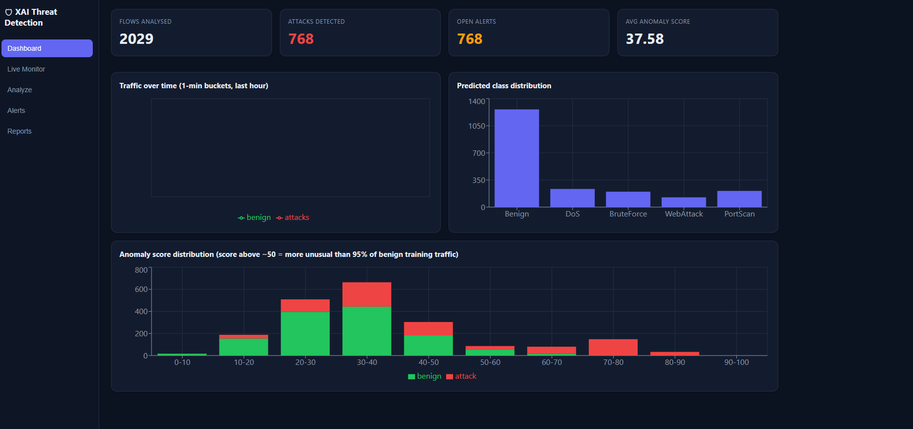
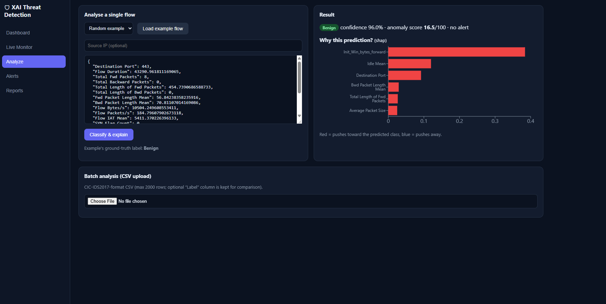
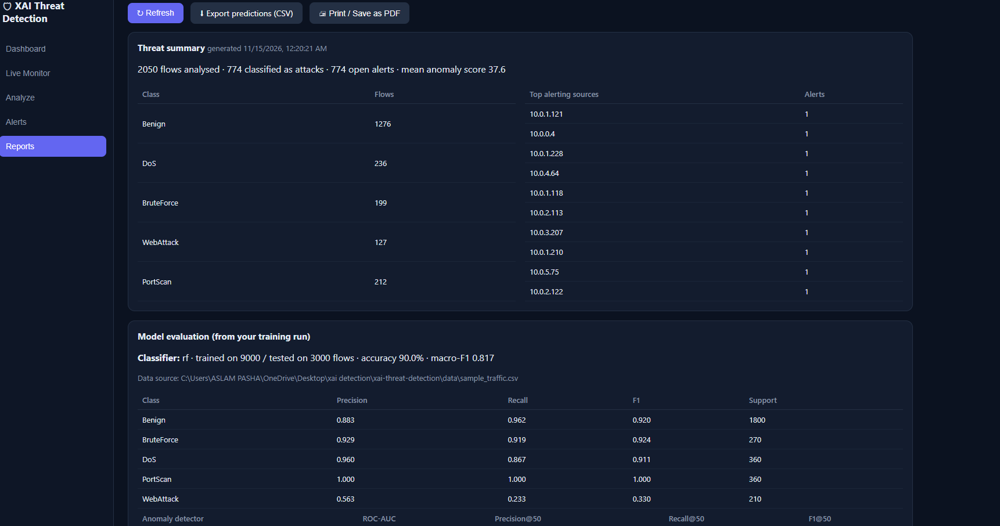
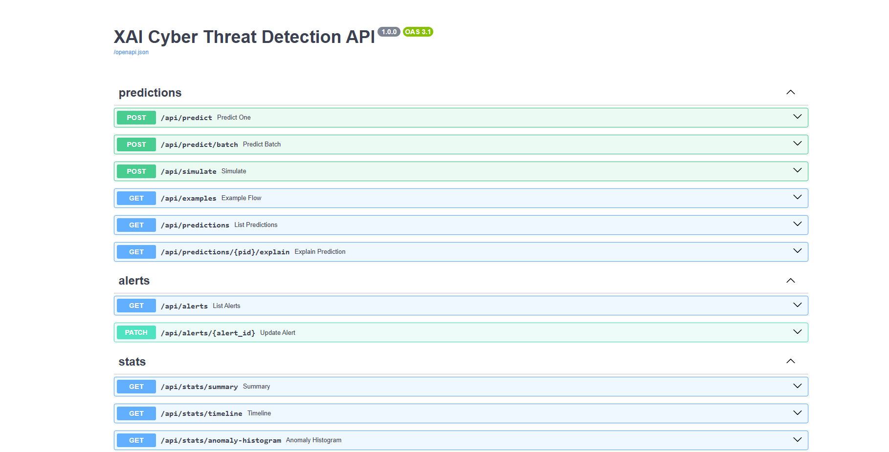
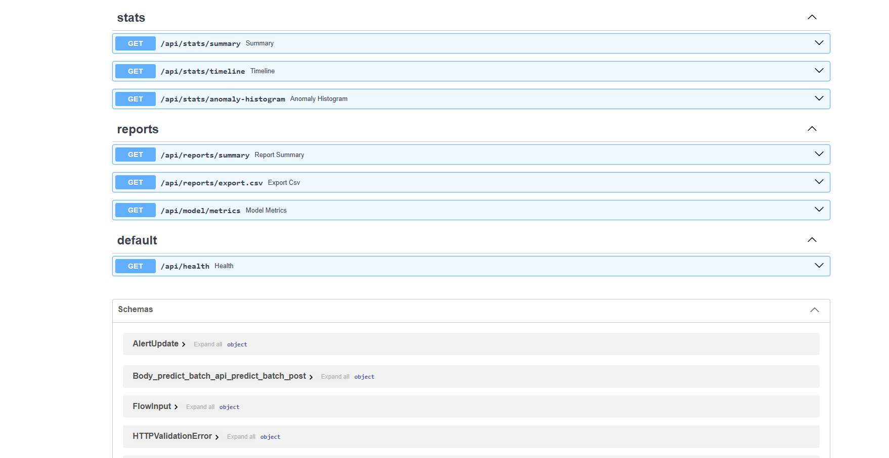

# Explainable AI-Based Intelligent Cyber Threat Detection and Network Anomaly Analysis System

An Explainable AI-based cybersecurity system that classifies network traffic, detects anomalous activity, and explains model predictions using SHAP.

The system combines machine learning, anomaly detection, explainable AI, a REST API backend, and an interactive web dashboard.

## Project Overview

The system analyses network traffic to identify known attack categories and unusual network behaviour. It provides prediction results, anomaly scores, feature-level explanations, security alerts, and reports through a web dashboard.

### Key Technologies

- **Random Forest** – Network attack classification.
- **Isolation Forest** – Anomaly detection.
- **Autoencoder** – Anomaly detection using reconstruction error.
- **SHAP** – Explaining machine learning predictions.
- **FastAPI** – Backend REST API services.
- **PostgreSQL** – Storing predictions and alerts.
- **React + Vite** – Interactive frontend dashboard.

## Main Features

- Network traffic classification.
- Anomaly detection using Isolation Forest and Autoencoder.
- Explainable predictions using SHAP.
- Dashboard with network statistics and visualizations.
- Sample traffic simulation through Live Monitor.
- Single-flow and batch analysis.
- Security alert generation and acknowledgement.
- Reports and CSV export.
- Interactive API documentation using Swagger.

## System Architecture

```text
              Network Traffic
                     |
                     v
              Data Preprocessing
                     |
          +----------+----------+
          |                     |
          v                     v
   Random Forest          Anomaly Detection
   Classification         Isolation Forest
                          and Autoencoder
          |                     |
          +----------+----------+
                     |
                     v
              Prediction Results
                     |
                     v
               SHAP Explanation
                     |
                     v
                FastAPI Backend
                     |
                     v
                 PostgreSQL
                     |
                     v
              React Dashboard
```

## Honest Project Status

The project has been successfully executed and tested in a local Windows environment.

| Component | Verified Status |
|---|---|
| Machine Learning | Random Forest, Isolation Forest and Autoencoder trained and evaluated |
| Backend | FastAPI successfully running |
| Database | PostgreSQL connection verified |
| Frontend | React + Vite application successfully launched |
| Prediction API | Single-flow and batch prediction tested |
| Explainable AI | SHAP explanation API tested |
| Live Monitor | Sample traffic simulation tested |
| Alerts | Alert generation and acknowledgement verified |
| Dashboard | Statistics and visualizations verified |
| Reports | Summary API and CSV export tested |

### Model Evaluation Results

| Metric | Result |
|---|---:|
| Random Forest Accuracy | 90% |
| Macro F1-score | 81.70% |
| Weighted F1-score | 88.78% |
| Autoencoder ROC-AUC | 72.32% |
| Isolation Forest ROC-AUC | 73.31% |

The classifier was evaluated on 3,000 test samples.

**Note:** WebAttack classification still requires improvement. The reported metrics are based on the project's synthetic sample dataset and local evaluation, not real-world network deployment.

### Testing Notes

- Batch analysis processed 2,000 sample network flows.
- SHAP returned feature-level explanations for individual predictions.
- PostgreSQL stored prediction and alert records.
- Alert acknowledgement was verified through the API and dashboard.
- Unit-test discovery: 15 tests run, 9 skipped, with no failures.

## Screenshots

### Main Dashboard


### Live Monitor


### Analyze and Prediction Result


### Alerts


### Reports


### Swagger API Documentation



## 1. Prerequisites

- Python 3.10–3.12
- Node.js 18+
- PostgreSQL 14+ or Docker
- VS Code (recommended)
- Git

## 2. Setup

Clone the repository:

```bash
git clone https://github.com/arbiyamaryam7-dotcom/xai-threat-detectionn.git
cd xai-threat-detectionn
```

Create a Python virtual environment from the project root:

```bash
python -m venv venv
```

Activate it on Windows PowerShell:

```powershell
.\venv\Scripts\Activate.ps1
```

Install Python dependencies:

```bash
pip install -r requirements.txt
```

Create the environment file:

```powershell
Copy-Item .env.example .env
```

Configure the required environment variables in `.env`. Use your own local database credentials. Do not upload `.env` to GitHub.

## 3. Database (PostgreSQL)

The project uses PostgreSQL to store network flow predictions and security alerts.

### Option 1: Using Docker

```bash
docker compose up -d
```

### Option 2: Using Local PostgreSQL

If Docker is not available, start your local PostgreSQL service and open the `psql` terminal.

Create the database user and database:

```sql
CREATE USER xai_user WITH PASSWORD 'replace_with_your_password';
CREATE DATABASE xai_threat OWNER xai_user;
```

Configure `DATABASE_URL` in `.env` using the same username, password, host, port, and database name.

The application automatically creates the required database tables when the backend starts.

## 4. Dataset

The repository includes:

`data/sample_traffic.csv`

This is a synthetic CIC-IDS2017-style sample dataset used for testing and demonstration.

For experiments with the original CIC-IDS2017 dataset:

1. Download the CIC-IDS2017 MachineLearningCSV dataset.
2. Extract the CSV files into `data/cicids2017/`.
3. Configure `SIMULATION_CSV` in `.env` to point to the appropriate dataset location.

See `data/README.md` for additional information.

## 5. Train the Models

Training is required before starting the backend if the model artifacts are not already available.

From the project root:

```bash
cd ml
python train_classifier.py
python train_anomaly.py
cd ..
```

For real CIC-IDS2017 data:

```bash
cd ml
python train_classifier.py --data ../data/cicids2017 --model rf
python train_anomaly.py --data ../data/cicids2017
cd ..
```

Generated model artifacts and evaluation metrics are stored in `ml/artifacts/`.

## 6. Run the Backend

Open a terminal from the project root:

```bash
cd backend
```

Activate the virtual environment if it is not already active in that terminal:

```powershell
..\venv\Scripts\Activate.ps1
```

Start the FastAPI backend:

```bash
uvicorn app.main:app --reload --port 8000
```

Backend health check:

`http://localhost:8000/api/health`

Interactive API documentation:

`http://localhost:8000/docs`

Keep the backend terminal running.

## 7. Run the Frontend

Open another terminal from the project root:

```bash
cd frontend
```

Install frontend dependencies:

```bash
npm install
```

Start the frontend:

```bash
npm run dev
```

Open the dashboard:

`http://localhost:5173/`

Keep the frontend terminal running.

## 8. Application Modules

### Dashboard

Displays network traffic statistics, detected attacks, open alerts, anomaly scores, and traffic visualizations.

### Live Monitor

Replays sample network traffic to demonstrate monitoring and simulated traffic analysis. It does not capture actual live network packets.

### Analyze

Allows users to load example network flows and perform single-flow or batch analysis. The system returns a predicted class and related analysis results.

### SHAP Explanation

Provides feature-level explanations to help understand which input features contributed to an individual model prediction.

### Alerts

Displays generated security alerts and supports alert acknowledgement.

### Reports

Provides report summaries and CSV export functionality.

## 9. API Summary

The backend exposes REST APIs under the `/api` prefix.

| Method | Endpoint | Purpose |
|---|---|---|
| POST | `/api/predict` | Predict one network flow |
| POST | `/api/predict/batch` | Analyse multiple network flows |
| POST | `/api/simulate` | Simulate network traffic |
| GET | `/api/examples` | Get example network flows |
| GET | `/api/predictions` | List previous predictions |
| GET | `/api/predictions/{pid}/explain` | Get SHAP explanation |
| GET | `/api/alerts` | List security alerts |
| PATCH | `/api/alerts/{alert_id}` | Update alert status |
| GET | `/api/stats/summary` | Get dashboard summary |
| GET | `/api/stats/timeline` | Get traffic timeline |
| GET | `/api/stats/anomaly-histogram` | Get anomaly score distribution |
| GET | `/api/model/metrics` | View model evaluation metrics |
| GET | `/api/reports/summary` | Get report summary |
| GET | `/api/reports/export.csv` | Export report as CSV |
| GET | `/api/health` | Check backend health |

## 10. Tests

Run from the project root after setting up the environment and training the models:

```bash
python -m unittest discover -s tests -v
```

The project also provides sample network flows for testing the prediction API and Analyze page.

## 11. Project Structure

```text
xai-threat-detectionn/
|
+-- backend/
|   +-- app/
|       +-- main.py
|       +-- config.py
|       +-- database.py
|       +-- models.py
|       +-- routers/
|       +-- services/
|
+-- data/
|   +-- sample_traffic.csv
|   +-- README.md
|
+-- frontend/
|   +-- src/
|       +-- pages/
|       +-- components/
|
+-- ml/
|   +-- config.py
|   +-- preprocess.py
|   +-- train_classifier.py
|   +-- train_anomaly.py
|   +-- anomaly.py
|   +-- explain.py
|
+-- tests/
|
+-- .env.example
+-- .gitignore
+-- docker-compose.yml
+-- requirements.txt
+-- README.md
```

## 12. Alert Rules

- Known attack classifications can generate high- or medium-priority alerts.
- Benign classifications with high anomaly scores can generate low-priority alerts for possible unknown threats.
- Alerts can be reviewed and acknowledged through the dashboard.

## 13. Limitations

- The current evaluation uses a synthetic CIC-IDS2017-style sample dataset, not the original full CIC-IDS2017 dataset.
- Real-world performance may differ from the reported sample evaluation metrics.
- WebAttack classification requires further improvement.
- The Live Monitor replays sample dataset rows rather than capturing actual live network packets.
- CIC-IDS2017 is a laboratory dataset from 2017 and has known dataset limitations.

## 14. Future Enhancements

- Evaluate the system on the original CIC-IDS2017 dataset.
- Improve detection of underrepresented attack classes.
- Integrate live network traffic capture.
- Improve anomaly detection and model performance.
- Add advanced security monitoring and reporting features.

## Author

**Arbiya Maryam**

Explainable AI-Based Intelligent Cyber Threat Detection and Network Anomaly Analysis System.
